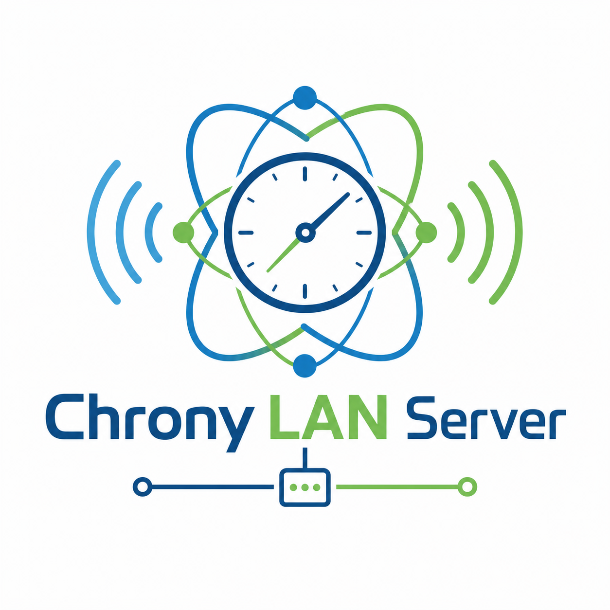

# hAI.chrony-status-dashboard
[](https://github.com/jbkunama1/hAI.chrony-status-dashboard)
[](https://github.com/jbkunama1/hAI.chrony-status-dashboard)
[](https://github.com/jbkunama1/hAI.chrony-status-dashboard)
[](https://github.com/jbkunama1/hAI.chrony-status-dashboard/pkgs/container/hai.chrony-status-dashboard)
[](LICENSE)


[](https://www.buymeacoffee.com/highfish)



> **Web-Dashboard für deinen Chrony-NTP-Server** – Flask-App, die `chronyc` ausführt und die Ausgabe im Browser darstellt. Docker-basiert, keine Datenbank.

---

## Features

- ⏳ **Uhrzeit** – lokale Zeit (Europe/Berlin) und UTC
- 📊 **Chrony-Status** – `tracking`, `sources -v`, `activity`, `clients`
- 🔁 **Auto-Refresh** – Seite lädt alle 60 Sekunden neu
- 🟥 **Fehleranzeige** – fehlgeschlagene Befehle werden rot markiert
- 🌙 **Dark/Light Mode** – per Klick umschaltbar
- 📱 **Mobil nutzbar** – responsive Oberfläche
- 🧩 **Minimaler Stack** – Python + Flask + chronyc

---

## Schnellstart

### Voraussetzungen
- Docker (+ Docker Compose oder Portainer)
- Laufender `chronyd` (siehe Hinweis unten)

### Docker

```bash
docker run -d \
  --name chrony-status-dashboard \
  --restart unless-stopped \
  -p 1234:1234 \
  ghcr.io/jbkunama1/hai.chrony-status-dashboard:latest
```

Danach erreichbar unter: **http://localhost:1234**

### Portainer Stack

```yaml
services:
  chrony-status-dashboard:
    image: ghcr.io/jbkunama1/hai.chrony-status-dashboard:latest
    container_name: chrony-status-dashboard
    restart: unless-stopped
    ports:
      - "1234:1234"
    networks:
      - highfishNetwork

networks:
  highfishNetwork:
    external: true
```

### Lokal bauen

```bash
git clone https://github.com/jbkunama1/hAI.chrony-status-dashboard.git
cd hAI.chrony-status-dashboard
docker compose up -d --build
```

---

## Update

- **Portainer:** Stack → Update → *Re-pull image* aktivieren → Update the stack
- **Lokal:** `git pull && docker compose up -d --build`

---

## Hinweis: Zugriff auf chronyd

Das Image enthält nur den Client `chronyc`, **keinen** `chronyd`. `chronyc` muss den Chrony-Dienst erreichen können. Aus einem Container im `highfishNetwork` ist der `chronyd` des Hosts nicht automatisch erreichbar. Dann zeigen die Boxen rote Fehlermeldungen.

Mögliche Wege:
- Chrony als eigener Container im selben Netzwerk (siehe [hAI.Chrony](https://github.com/jbkunama1/hAI.Chrony)) und `chronyc` darauf konfigurieren
- Host-Chrony mit `bindcmdaddress` und `cmdallow` freigeben
- Dashboard mit `network_mode: host` betreiben

Für die Clients-Ansicht in der `chrony.conf`: `noclientlog` deaktivieren und `clientloglimit` > 0 setzen.

---

## Projektstruktur

```
hAI.chrony-status-dashboard/
├── app.py              # Flask-App, führt chronyc aus
├── templates/
│   └── index.html      # Dashboard-Seite
├── static/
│   ├── style.css
│   └── theme.js        # Dark/Light-Toggle
├── Dockerfile
├── docker-compose.yml
├── requirements.txt
├── docs/MEMORY.md
└── .github/workflows/  # GHCR-Build, TruffleHog
```

---

## Architektur

```text
Browser ──HTTP :1234──> Flask-App ──shell──> chronyc (tracking, sources, activity, clients)
         <─HTML─────────             <─Text──
```

---

## CI / GHCR

- Push auf `main` → Build und Push nach `ghcr.io/jbkunama1/hai.chrony-status-dashboard:latest`
- Build auch nach PR-Merge und manuell (`workflow_dispatch`)
- Den tatsächlichen Status unter [Actions](https://github.com/jbkunama1/hAI.chrony-status-dashboard/actions) prüfen

---

## Troubleshooting

| Problem | Prüfen |
|---|---|
| Seite zeigt 500 / `command_failed is undefined` | Aktuelles Image ziehen (Fix seit Commit `3fb2f32`) |
| Rote Fehlerboxen bei allen Befehlen | `chronyd` aus dem Container erreichbar? Siehe Hinweis oben |
| Clients-Box leer | `noclientlog` aus, `clientloglimit` > 0, `cmdallow` gesetzt |
| `manifest unknown` / `denied` beim Pull | Build erfolgreich? GHCR-Paket öffentlich? |
| Port belegt | Host-Port in `ports:` ändern, z. B. `"8234:1234"` |
| Netzwerk nicht gefunden | `docker network create highfishNetwork` |

---

## Lizenz

MIT – siehe [LICENSE](LICENSE)
